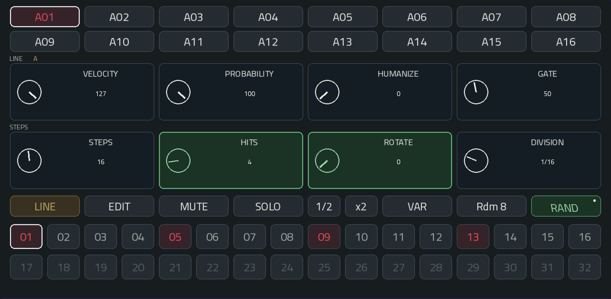

# πClideaN

**Version 1.4.1 · Sixteen-lane hybrid MIDI sequencer for Akai MPC OS**



Build evolving rhythmic and melodic patterns with sixteen independent lanes, per-step expression, scales and a native touch interface. Drive synthesizers, drum instruments and sample tracks through the plugin’s dedicated MIDI output.

## Maintenance 1.3.8

Installation now follows Akai's official SDK rule: copy one plugin folder into `VST2 Plugins`, restart MPC, nothing else. No installer script, no `Synths` folder, no MPC.settings entry. Engine fixes from a code review, MOD and CONFIG selectors follow the shared colour charter (blue outline when a selector has no neutral value, amber once it leaves OFF/NONE), thinner orange playhead, larger MOD slider values. Parameters, UID, presets and project format are unchanged.

[Release notes](docs/RELEASE-NOTES-1.3.8.md). Gen2 remains untested on hardware.

## Maintenance 1.4.1

Installation now follows Akai's official SDK rule: copy one plugin folder into `VST2 Plugins`, restart MPC, nothing else. No installer script, no `Synths` folder, no MPC.settings entry. Engine fixes from a code review, MOD and CONFIG selectors follow the shared colour charter (blue outline when a selector has no neutral value, amber once it leaves OFF/NONE), thinner orange playhead, larger MOD slider values. Parameters, UID, presets and project format are unchanged.

[Release notes](docs/RELEASE-NOTES-1.4.1.md). Gen2 remains untested on hardware.

## Maintenance 1.3.7

More controlled preset/project recalls, coherent saves with formatting outside the engine mutex, synchronized controls, transient MIDI warnings and official architecture-specific plugin manifests. The musical workflow and touch interface are unchanged.

[Release notes](docs/RELEASE-NOTES-1.3.7.md) · [Validation scope](docs/VALIDATION-1.3.7.md). Gen2 remains untested on hardware.

## Features

- Compact selection panels over the dimmed current screen, yellow opening selectors and 36 px panel buttons.


- Per-line rhythmic A/B variants, COPY A → B and guided ALTER.
- Separate VAR and two-stage RAND controls, with no long press.
- Compact, attributed rhythmic preferences derived offline from Groove MIDI Dataset.
- Seven native presets and contextual physical Q-Links.


- Scale and mode assignment across sixteen lanes, with a selectable root and register.
- RAND, ALTER and RDM 8 cap generated trigger density at 75%. RDM 8 coordinates lanes 01–08 and preserves notes and MUTE states; 09–16 stay untouched.
- Native choice panels for modulation settings, scales and playback direction.


- Four independent modulation slots, each with two LFOs and a bipolar MIX control.
- Eleven waveform/generator choices, with cross-LFO rate, depth and offset modulation.
- Cached background waveform previews and streamlined track graphics.
- Static four-bar waveform previews, configurable destinations and threshold-based Note On.
- One CONFIG page for all sixteen MIDI notes and GATE / HOLD modes.

- Sixteen lanes with 1–32 steps each.
- Euclidean Steps, Hits and Rotate controls, with five rhythmic divisions.
- Selective randomization of lane parameters with a two-stage RAND control.
- Per-lane velocity, probability, velocity humanization and gate length.
- Per-step velocity, probability, GATE, ratchet and ratchet decay, with full purple lock indicators.
- Forward, reverse, two pendulum modes and shuffled traversal.
- Automatic pattern rotation at a configurable cycle interval.
- Per-lane GATE / HOLD for short hits and sustained notes.
- Touch selection, note drawing, contextual erase, mute and solo.
- Rounded controls and inset circular status indicators across the plugin pages.
- Read-only LINE references in EDIT, with per-step controls kept active.
- Dimmed lane selectors for explicitly muted lanes, preserving selection and activity feedback.
- Azure activity pulses on all sixteen lane buttons during playback.
- Eight contextual Q-Link controls and native project state storage.
- Independent MIDI client, output port and scheduling queue for each instance.

The plugin generates MIDI only. Use a separate target instrument or sample track to produce sound.

## Screenshots

### MOD — dual LFO modulation


### Tracks — pattern overview and playback controls


### CONFIG — MIDI notes and GATE / HOLD


## Download and setup

Choose the folder for your device. Both builds use πClideaN **1.4.1**.

| Device generation | Architecture | Download | Installation |
| --- | --- | --- | --- |
| **Gen1 / Force** and **Gen2** | **ARM32** + **ARM64** in one folder | [piClideaN-1.4.1-mpc-sdk.zip](https://github.com/timomacquis/piClideaN-MPC/releases/download/v1.4.1/piClideaN-1.4.1-mpc-sdk.zip) | [Installation guide](docs/INSTALLATION.md) · [Gen2 guide](docs/INSTALLATION-GEN2.md) |

Unzip, copy the folder **`Timo - VST - πClideaN`** into **`VST2 Plugins`** at the root of a drive (User Memory: `/sdcard/VST2 Plugins`), then restart MPC. This is the installation method defined by Akai's plugin SDK. Gen2 packages are built from the same sources with the Live III skin workaround and await device validation. Thanks to Thomas Phillips for the original Gen2 port.

## Documentation

- [User manual](docs/USER-MANUAL.md) · [Standalone illustrated manual](docs/USER-MANUAL.html)
- [MIDI engine](docs/ENGINE.md)
- [Implementation](docs/IMPLEMENTATION.md)
- [Build from source](docs/BUILD.md) · [Release procedure](docs/RELEASING.md)
- [Third-party notices](THIRD_PARTY.md)

## Repository layout

```text
src/                MIDI engine
scripts/            Parameter, skin, build and package tools
docs/               User and developer documentation
reference/          Skin schema, note map and font inputs
third_party/        Pinned wrapper, generator and ALSA headers
licenses/           Dependency license notices
params.json         Parameter definitions
params.lock         Fixed parameter indices
vst.json            Plugin build configuration
```

## Requirements

Akai MPC OS 3.10.1 or later with **Preferences → Enhancements (Beta) → Enable Enhancements** and **External Plugin Support** switched on. Tested on an Akai Force (Gen1). The plugin folder must be on a drive that allows executable plugins; the internal User Memory always does.

## License

MIT. See [LICENSE](LICENSE) and [THIRD_PARTY.md](THIRD_PARTY.md).
