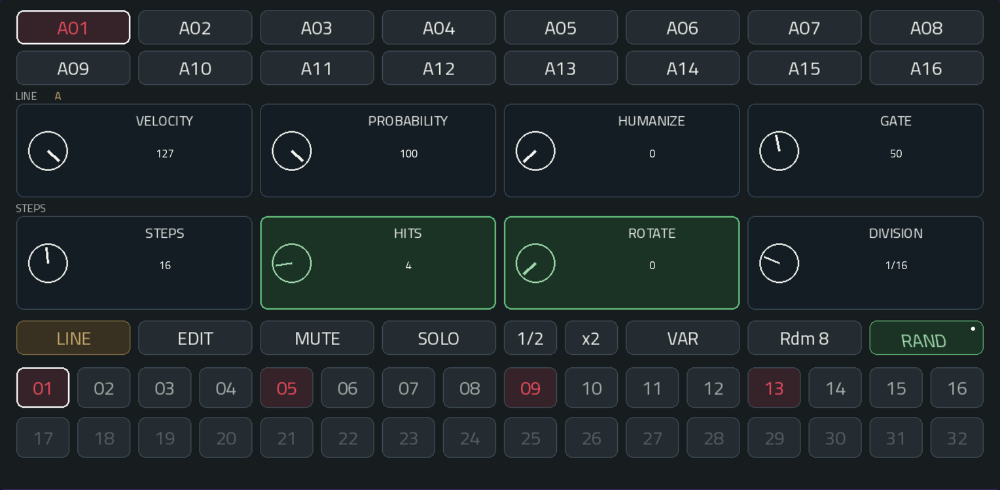

# πClideaN

**Version 1.3.4 · Sixteen-lane hybrid MIDI sequencer for Akai MPC OS**



Build evolving rhythmic and melodic patterns with sixteen independent lanes, per-step expression, scales and a native touch interface. Drive synthesizers, drum instruments and sample tracks through the plugin’s dedicated MIDI output.

## Features

- Per-line rhythmic A/B variants, COPY A → B and guided ALTER.
- Separate VAR and two-stage RAND controls, with no long press.
- Compact, attributed rhythmic preferences derived offline from Groove MIDI Dataset.
- Seven native presets and contextual physical Q-Links.


- Scale and mode assignment across sixteen lanes, with a selectable root and register.
- RAND, ALTER and Rdm 8 cap generated trigger density at 75%. Rdm 8 coordinates lanes 01–08 and preserves notes and MUTE states; 09–16 stay untouched.
- Native choice panels for modulation settings, scales and playback direction.


- Four independent modulation slots, each with two LFOs and a bipolar MIX control.
- Eleven waveform/generator choices, with cross-LFO rate, depth and offset modulation.
- Cached background waveform previews and streamlined track graphics.
- Static four-bar waveform previews, configurable destinations and threshold-based Note On.
- One CONFIG page for all sixteen MIDI notes and GATE / HOLD modes.

- Sixteen lanes with 1–32 steps each.
- Euclidean Steps, Hits and Rotate controls, with five rhythmic divisions.
- Selective randomization of lane parameters with a two-stage RAND control.
- Per-lane velocity, probability, velocity humanization and gate length.
- Per-step velocity, probability, GATE, ratchet and ratchet decay, with full purple lock indicators.
- Forward, reverse, two pendulum modes and shuffled traversal.
- Automatic pattern rotation at a configurable cycle interval.
- Per-lane GATE / HOLD for short hits and sustained notes.
- Touch selection, note drawing, contextual erase, mute and solo.
- Rounded controls and inset circular status indicators across the plugin pages.
- Read-only LINE references in EDIT, with per-step controls kept active.
- Dimmed lane selectors for explicitly muted lanes, preserving selection and activity feedback.
- Azure activity pulses on all sixteen lane buttons during playback.
- Eight contextual Q-Link controls and native project state storage.
- Independent MIDI client, output port and scheduling queue for each instance.

The plugin generates MIDI only. Use a separate target instrument or sample track to produce sound.

## Screenshots

### MOD — dual LFO modulation


### Tracks — pattern overview and playback controls


### CONFIG — MIDI notes and GATE / HOLD


## Download and setup

Choose the package for your device. Both builds use πClideaN **1.3.2**.

| Device generation | Architecture | Download | Installation |
| --- | --- | --- | --- |
| **Gen1 / Force** | **ARM32** — ARMv7 | [Gen1 / ARM32 ZIP](https://github.com/timomacquis/piClideaN16-MPC/releases/download/v1.3.4/ClideaN-MPC-1.3.4-mpc-armv7.zip) | [Gen1 / Force guide](docs/INSTALLATION.md) |
| **Gen2** | **ARM64** — AArch64 | [Gen2 / ARM64 ZIP](https://github.com/timomacquis/piClideaN16-MPC/releases/download/v1.3.4/ClideaN-MPC-1.3.4-mpc-aarch64.zip) | [Gen2 guide](docs/INSTALLATION-GEN2.md) |

The 1.3.2 loop-continuity fix was validated on Force as candidate.1. Gen2 packages are built from the same sources with the Live III skin workaround and await device validation. Thanks to Thomas Phillips for the original Gen2 port. See [Gen2 validation](docs/GEN2-VALIDATION.md).

## Documentation

- [User manual](docs/USER-MANUAL.md) · [Standalone illustrated manual](docs/USER-MANUAL.html)
- [MIDI engine](docs/ENGINE.md)
- [Implementation](docs/IMPLEMENTATION.md)
- [Build from source](docs/BUILD.md) · [Release procedure](docs/RELEASING.md)
- [Third-party notices](THIRD_PARTY.md)

## Repository layout

```text
Installation/       Installable ARMv7 ZIP and checksum
src/                MIDI engine
scripts/            Parameter, skin, build and package tools
docs/               User and developer documentation
reference/          Skin schema, note map and font inputs
third_party/        Pinned wrapper, generator and ALSA headers
licenses/           Dependency license notices
params.json         Parameter definitions
params.lock         Fixed parameter indices
vst.json            Plugin build configuration
```

## Requirements

Akai Gen1 (Tested on Akai FORCE) running an OS environment that supports community ARMv7 VST2 plugins and native plugin skins. This is not a stock firmware add-on installer. SSD installation requires executable access to the SSD's `Synths` directory. The package uses regular files and requires no symbolic links.

## License

MIT. See [LICENSE](LICENSE) and [THIRD_PARTY.md](THIRD_PARTY.md).
