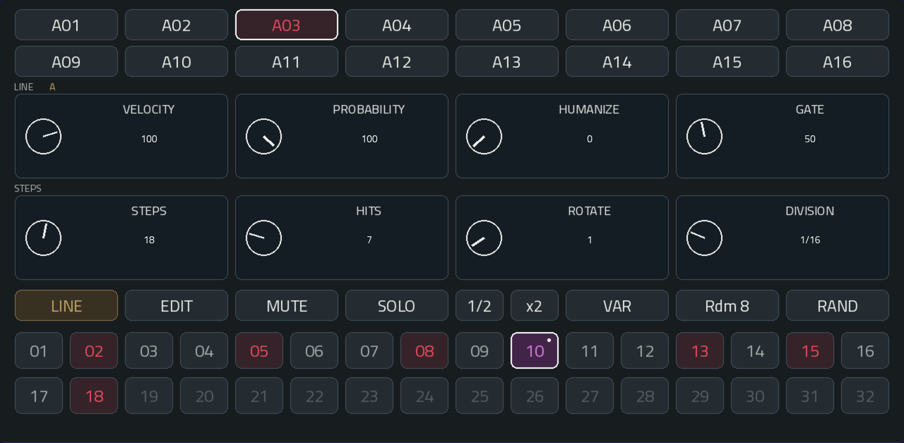
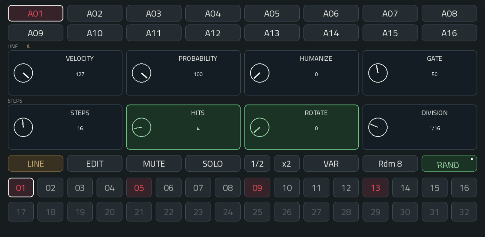
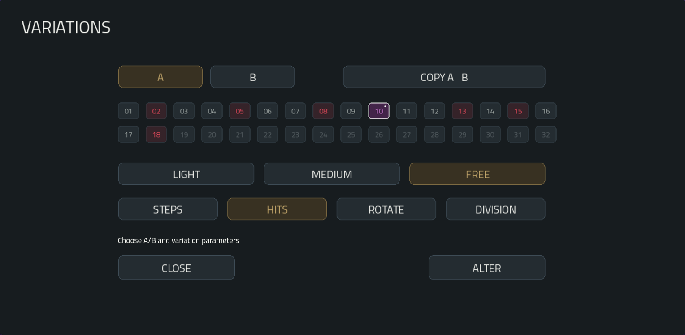
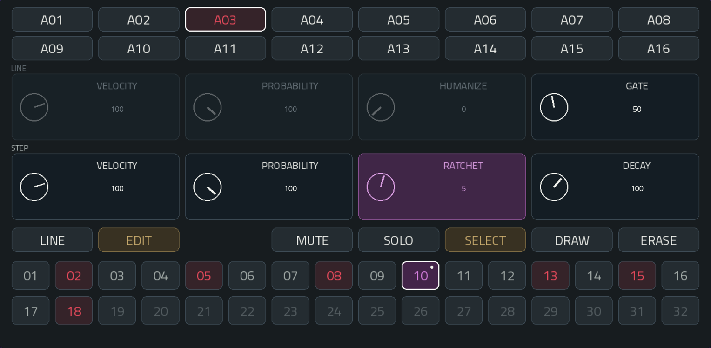
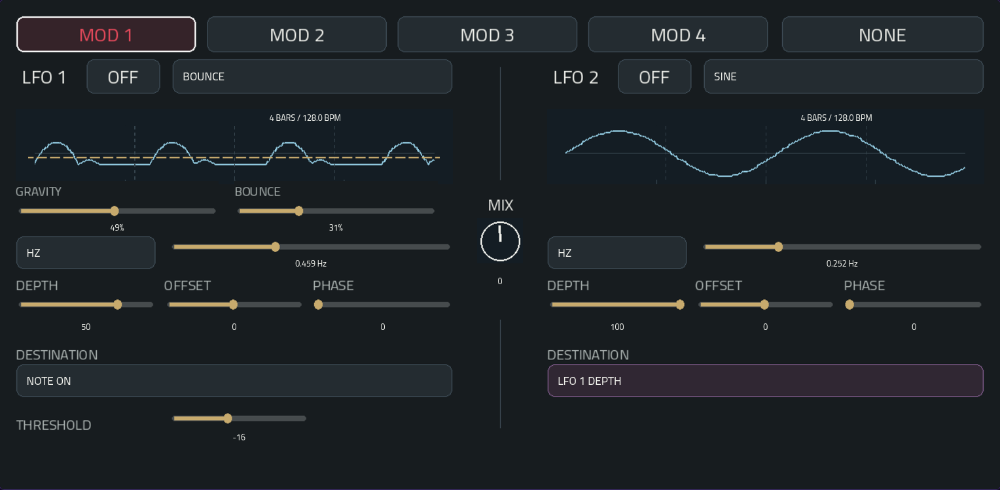
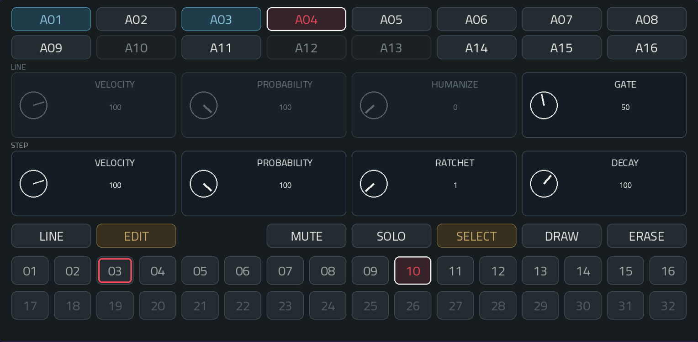
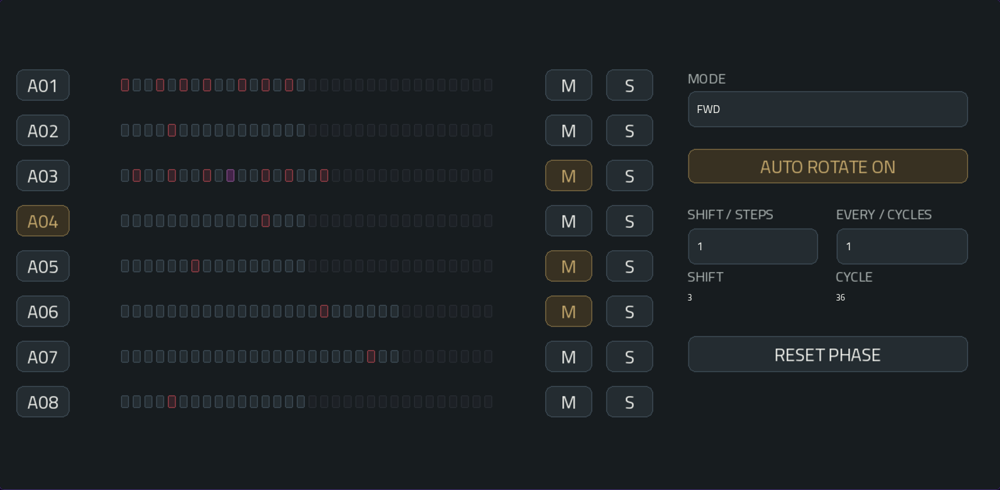
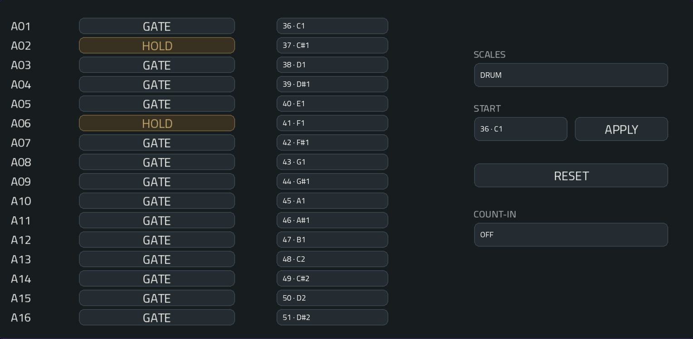
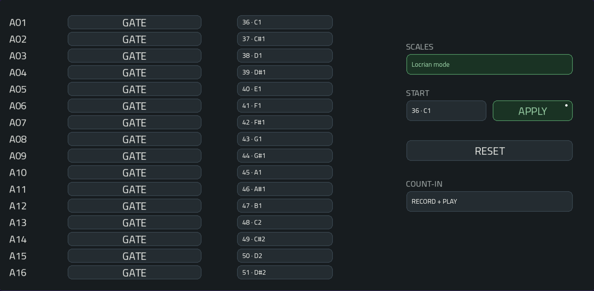

# πClideaN — Mode d’emploi

Version 1.3.4

Illustrations capturées avec Commander, à partir du skin actuel et des réglages de l’instrument.

## 1. Principe

πClideaN est un instrument MIDI : il ne produit aucun son. Il pilote un synthétiseur, un instrument de batterie ou une piste de samples via sa sortie MIDI dédiée.

C'est un séquenceur hybride qui associe génération euclidienne, édition pas à pas, parameter locks, randomisation sélective et probabilités. 
Mais également l’autorotation, les différents sens de lecture, et la modulation par LFO, permettent de faire évoluer les motifs et leurs déclenchements.

Ses seize pistes possèdent chacune une longueur de motif et une division rythmique indépendantes. 
Elles peuvent ainsi boucler sur des durées différentes tout en restant synchronisées au tempo, créant des polymètres et des décalages rythmiques évolutifs.

Cinq onglets : PATTERN, MOD, 01 - 08, 09 - 16 et CONFIG. 

**A01–A16** sélectionnent un pattern, autrement dit une ligne.

Le contour blanc indique le pattern sélectionné.

## 2. Connecter une cible

Choisis les sons que tu veux jouer. πClideaN apporte le rythme.

Charge πClideaN sur une piste plugin, puis charge l’instrument à jouer sur une autre piste : synthétiseur, instrument de batterie ou piste Drum.

Sur cette cible, sélectionne l’entrée MIDI :

`piClideaN MPC Out`

Reçois le **canal 1** ou tous les canaux. Chaque instance possède son port ; les suivants sont numérotés.

Ouvre CONFIG et associe chaque **MIDI NOTE** à une hauteur ou au son voulu.

Pour jouer des notes mélodiques, choisis une **SCALE** et une note **START**, puis **APPLY**. Pour un kit de batterie, adapte les notes à ses pads.

Les notes initiales sont **36–51**. Toute la sortie utilise le canal 1.

Lance le transport de l’hôte. πClideaN suit son tempo, sa position et ses boucles.

Utilise des notes distinctes pour les sons indépendants et évite de recevoir deux fois la même sortie.

## 3. PATTERN — LINE

Choisis **A01–A16**, puis **LINE**. Construis un motif et donne son caractère à toute la ligne.

### Dessiner le rythme

La rangée STEPS construit le motif :

**STEPS** choisit sa longueur : 1–32 pas.

**HITS** répartit 0–STEPS frappes sur cette longueur.

**ROTATE** déplace le motif généré autour de son cycle.

**DIVISION** donne la durée de chaque pas : 1/32, 1/16, 1/8, 1/4 ou 1/2 note.

Essaie des longueurs et divisions différentes entre les lignes pour entendre leurs cycles se croiser et se décaler.

Les déclenchements manuels prennent la priorité sur le motif généré. Les données hors de la longueur courante restent mémorisées.

### Donner de l’expression

La rangée LINE façonne le jeu de la ligne :

**VELOCITY** règle la force des frappes : 1–127.

**PROBABILITY** laisse une chance aux silences : 0–100 % de probabilité de jouer le groupe, ratchets compris.

**HUMANIZE** fait varier la vélocité jusqu’à l’écart choisi : 0–50, une fois par groupe.

**GATE** règle la tenue des notes : 10–95 % du pas ou de la subdivision de ratchet. Il agit en mode GATE ; voir CONFIG pour HOLD.

### Jouer avec la ligne

**MUTE** coupe la ligne.

**SOLO** permet d’écouter une ou plusieurs lignes ensemble. Mute reste prioritaire.

Les boutons actifs passent à l’**ambre**.

**1/2** ralentit la ligne.

**x2** l’accélère.

Ces deux commandes parcourent les divisions rythmiques disponibles.

### RAND sélectif

Garde ce qui te plaît. Laisse le hasard explorer le reste.

Un premier appui sur **RAND** ouvre la sélection. Le bouton devient vert et italique, avec un petit point blanc.

Touche les paramètres à faire varier. Ils passent au **vert** ; leurs valeurs restent inchangées pour le moment.

Un second appui sur **RAND** applique le tirage. Seuls les paramètres sélectionnés changent, puis la sélection se ferme.

Les huit contrôles sont disponibles, dans les rangées LINE et STEPS. L’illustration sélectionne **HITS et ROTATE**.

Sans sélection, rien ne change. Changer de ligne ou de mode LINE/EDIT annule la sélection.

Q-Links, 1/2 et x2 sont en pause pendant celle-ci.

Un nouveau Steps respecte Hits et Rotate non sélectionnés. Si RAND change Steps, Hits ou Rotate, les déclenchements manuels sont effacés ; l’expression par pas reste conservée.

Un tirage peut redonner la même valeur.

RAND, ALTER et Rdm 8 limitent les pas actifs générés à **75 % de la longueur de chaque ligne**, arrondis vers le bas (12/16, 24/32). L’édition manuelle reste libre. RAND sélectif conserve les paramètres non sélectionnés ; si le plafond est impossible à respecter, la ligne reste intacte et la sélection se ferme. Une ligne générée d’un seul pas est silencieuse. Cette limite ne réduit ni les répétitions ratchet ni les déclenchements LFO indépendants.

### ALTER et A/B — faire évoluer une ligne

Touche **VAR** pour ouvrir VARIATIONS. **RAND** conserve la sélection des paramètres puis l’application au deuxième appui ; aucun appui long n’est nécessaire.

Choisis **STEPS, HITS, ROTATE et/ou DIVISION**, puis **LIGHT, MEDIUM ou FREE** pour doser les changements. Touche **ALTER** : une recherche guidée compare la proximité du motif, ses appuis, sa densité et ses respirations.

**A / B** choisit l’une des deux versions rythmiques de la ligne sélectionnée. Au premier usage, elles sont identiques. Tes modifications appartiennent à la version choisie.

**COPY A → B** remplace B par A et sélectionne B. Une façon simple de préparer une copie de départ.

Depuis **A**, **ALTER** garde A et prépare son résultat dans B. Depuis **B**, un nouvel ALTER développe B en conservant A. **CLOSE** revient à PATTERN en gardant la version sélectionnée active.

**LIGHT** reste proche du motif de départ. **MEDIUM** autorise davantage de changement. **FREE** explore plus largement, en respectant les paramètres protégés et la densité maximale. Ce n’est pas une remise à zéro sans contraintes.

La capture prépare une variation de **HITS seulement**, en FREE. L’aperçu de 32 pas conserve les couleurs des frappes, des locks et des pas inutilisés.

Le passage A/B est immédiat : il n’attend pas la mesure suivante. Les notes tenues par cette ligne sont relâchées.

A/B conserve rythme et personnalisations par pas. Notes, paramètres LINE, MUTE/SOLO, HOLD, parcours et MOD restent communs. Les personnalisations restent à leur numéro de pas, même lorsqu’un raccourcissement les masque. Une variation incompatible avec les protections ou la densité laisse la ligne intacte.

### Rdm 8 — construire huit motifs ensemble

Touche **Rdm 8**, puis **APPLY**. **CANCEL** ne change rien.

Les lignes **01–08** sont générées ensemble : appuis, réponses et espaces sont recherchés sur une grille temporelle commune. Les lignes **09–16 restent intactes**.

Sur 01–08, les personnalisations et variantes A/B sont effacées ; Velocity et Probability reviennent à 100, Humanize à 0 et Gate à 50. HOLD, Solo, parcours et auto-rotation sont réinitialisés ; les emplacements MOD affectés à ces huit lignes repassent sur NONE/OFF.

Un SOLO conservé sur 09–16 peut rendre les nouvelles lignes 01–08 inaudibles.

Les **MUTE**, les **hauteurs MIDI** et la **gamme appliquée** restent conservés. Le calcul se fait en arrière-plan ; un changement de contexte pendant la recherche peut annuler sa proposition.

Pour démarrer : génère huit lignes avec Rdm 8, garde les lignes indésirables mutées, puis développe une ligne à la fois avec VAR.

## 4. PATTERN — EDIT

Donne son propre caractère à une frappe.

Sur la capture, **A03 / pas 10** possède **RATCHET 5**. L’encart entier et le pas violets signalent ce réglage personnalisé.

Choisis **EDIT**, puis un pas. La rangée **STEP** lui appartient maintenant.

**VELOCITY** remplace sa vélocité de ligne : 1–127.

**PROBABILITY** remplace sa probabilité de ligne : 0–100 %. Les deux probabilités ne sont pas multipliées.

**RATCHET** transforme le pas en 1–8 frappes régulièrement espacées.

**DECAY** façonne leur vélocité : 0–150 % de la répétition précédente. À 100, elles restent égales ; en dessous, elles s’atténuent ; au-dessus, elles montent, dans la limite de 127.

À DECAY 0, seule la première frappe joue. Avec une seule frappe, Decay n’a aucun effet.

Sans personnalisation, vélocité et probabilité suivent la ligne ; ratchet vaut 1 et decay 100.

**GATE**, en haut à droite dans EDIT, verrouille la durée du pas sélectionné : 10–95 % du pas ou de chaque subdivision ratchet. Sans lock, il hérite du GATE de LINE. HOLD garde la priorité ; revenir en GATE retrouve les durées enregistrées.

Tout l’encart du contrôle devient **violet** lorsqu’un lock est enregistré sur le pas. Les autres références LINE de la rangée supérieure restent en lecture seule. ERASE en SELECT efface les locks d’expression du pas, GATE compris ; en DRAW, il retire le déclenchement.

### Sélectionner, dessiner, effacer

**SELECT** explore un pas sans changer son déclenchement.

**DRAW** active ou désactive le déclenchement touché.

Modifier l’expression seule ne crée pas de note.

**ERASE** suit ton mode d’édition :

- En SELECT, efface l’expression personnalisée et conserve le déclenchement.
- En DRAW, retire le déclenchement et conserve son expression.

Les modifications sont immédiates, sans annulation.

En EDIT, VELOCITY, PROBABILITY et HUMANIZE restent des références de ligne grisées. Le GATE supérieur agit sur le pas sélectionné. Reviens en LINE pour modifier les valeurs générales.

## 5. MOD — deux LFO par emplacement

Ajoute du mouvement à une ligne, ou laisse une forme d’onde créer ses propres déclenchements.

Choisis **MOD 1–MOD 4**, puis affecte un **PAD** dans le panneau de sélection.

Chaque ligne peut utiliser un emplacement. Par défaut, tous les emplacements sont sur **NONE** et les LFO sur **OFF**.

La sélection MOD ne change pas la ligne choisie dans PATTERN.

Pour entendre le routage illustré, affecte une ligne et active les LFO concernés. La capture prépare BOUNCE → NOTE ON et LFO 2 → LFO 1 DEPTH, avec les LFO encore sur OFF.

### Construire le mouvement

Passe le LFO sur **ON**, puis choisis sa forme :

Sine, Triangle, Ramp Up, Ramp Down, Square, Sample & Hold, Random Smooth, Free Curve, Random Walk, Random Loop ou Bounce.

**SQUARE** règle la largeur d’impulsion. **RANDOM WALK** ajuste la taille des déplacements aléatoires. **RANDOM LOOP** règle la longueur et l’évolution de la boucle. **BOUNCE** règle la gravité et le rebond.

**SYNC** cale son cycle sur le tempo : de 1/16 de note à 4 mesures.

**HZ** règle sa fréquence indépendamment : 0,05–20 Hz.

**DEPTH** dose la modulation : −100 à +100. Les valeurs négatives l’inversent.

**OFFSET** décale son niveau. **PHASE** décale sa position dans le cycle : 0–359°.

En **FREE CURVE**, dessine ta propre forme avec huit sliders.

Choisis une **DESTINATION** :

NONE, Velocity, Probability, Humanize, Gate, Ratchet, Decay ou Note On.

La modulation des paramètres agit sur la lecture. Les valeurs enregistrées dans tes lignes et tes pas restent intactes.

### Chaîner les deux LFO

Choisis **LFO 2 RATE, DEPTH ou OFFSET** comme destination du LFO 1, ou l’inverse pour le LFO 2.

Une forme fait alors évoluer l’autre : par exemple, Random Walk fait varier la profondeur d’un LFO qui déclenche des notes.

Les réglages enregistrés restent intacts. Si les deux LFO se modulent mutuellement, le calcul utilise la valeur précédente et reste borné.

La destination chaînée apparaît en violet ; un petit point repère le paramètre modulé. MIX reste un réglage distinct du chaînage.

### Mélanger les deux formes

Tourne **MIX** vers la source à privilégier dans la modulation :

- −100 : LFO 1 seul.
- 0 : mélange égal.
- +100 : LFO 2 seul.

Chaque LFO garde sa destination. Une source activée sur NONE peut toujours alimenter le mélange.

### Laisser le LFO lancer les notes

Choisis **NOTE ON**, puis règle **THRESHOLD** :

Un franchissement montant du seuil lance une note.

Un franchissement descendant la relâche.

Pendant cette tenue, les déclenchements des pas sur la même note/canal sont suspendus.

Le séquenceur continue d’avancer, puis reprend au prochain déclenchement normal après relâchement.

### Lire les courbes

Les aperçus montrent **quatre mesures** au tempo courant. Ils restent fixes jusqu’à la modification d’un réglage concerné.

Le pointillé ambré marque le seuil. Chaque courbe montre sa source ; les franchissements réels dépendent du mélange.

Les formes aléatoires montrent un exemple, pas la prochaine suite jouée. Les ondes périodiques très rapides peuvent apparaître en bande d’amplitude ; les formes aléatoires conservent une trajectoire.

OFF et les lignes inaudibles suspendent la phase. La reprise conserve cette phase sans lancer immédiatement une note déjà au-dessus du seuil.

Réaffecter un PAD libère sa précédente note LFO.

## 6. État Mute et activité des lignes

Suis le rythme en regardant **A01–A16**.

Sur la capture, **A04** reste sélectionnée pendant que **A01 et A03** pulsent en azur. Les boutons atténués repèrent les lignes mutées ; le contour rouge interne du pas 03 marque la tête de lecture.

Une **impulsion azur** indique qu’une note émise arrive à son heure de lecture. Ta ligne sélectionnée garde son contour blanc.

Lignes mutées, exclues du solo, silences et frappes rejetées par probabilité ne pulsent pas. Une impulsion dure environ 140 ms ; les ratchets rapides peuvent fusionner visuellement.

HOLD signale les redéclenchements, pas toute la tenue. Ce retour représente l’activité MIDI, pas une mesure du son.

Les boutons des lignes mutées sont atténués. Les sélectionner ne les démute pas ; leur contour de sélection reste visible. L’exclusion par Solo seule ne les grise pas.

### Les couleurs en un regard

**Pas rouge :** déclenchement actif.

**Pas violet :** expression personnalisée. Un silence violet reste silencieux.

**Contour blanc externe :** pas sélectionné.

**Contour rouge interne :** tête de lecture.

**Bouton ambré :** mode ou état actif.

**Vert :** sélection RAND.

Un encart de paramètre violet indique un lock du pas sélectionné. Le pas devient violet lorsqu’il possède des locks ; son petit point reste un indicateur complémentaire. Sur un bouton de ligne, il indique une destination de modulation activée.

## 7. 01 - 08 / 09 - 16 — lecture et rotation

Prends du recul et regarde huit lignes jouer ensemble.

Sélectionne une ligne pour travailler avec ses commandes à droite. **M** et **S** agissent sur leur propre rangée.

Chaque aperçu montre 32 pas. Les motifs mutés restent visibles ; un contour clair marque la lecture sans cacher la couleur du pas.

### Changer de direction

Touche **MODE** pour ouvrir le panneau des parcours. Choisis un mode : il s’applique et le panneau se ferme. **CANCEL** conserve le mode courant.

**FWD / REV :** avance ou recule.

**PEND1 :** fait l’aller-retour en répétant les extrémités : 1–2–3–4–4–3–2–1.

**PEND2 :** repart sans répéter les extrémités : 1–2–3–4–3–2.

**URN :** visite chaque pas une fois, dans un ordre mélangé à chaque cycle.

### Faire tourner le motif

Passe **AUTO ROTATE sur ON**.

**SHIFT / STEPS** choisit le déplacement : −8 à +8 pas. Une valeur négative tourne dans l’autre sens.

**EVERY / CYCLES** choisit l’intervalle : 1–16 cycles de ligne. Par exemple, SHIFT / STEPS 1 et EVERY / CYCLES 2 déplacent le motif d’un pas tous les deux cycles complets de la ligne.

Le cycle dépend du parcours, pas nécessairement d’une mesure hôte. Les expressions suivent leur déclenchement ; la sélection suit ses données.

**RESET PHASE** demande une remise en phase à la prochaine frontière de pas en lecture.

Les petits compteurs **SHIFT** et **CYCLE** affichent la rotation cumulée et le cycle courant.

Sur la capture, **A04** est sélectionnée et AUTO ROTATE est actif. Les boutons M ambrés coupent A03, A05 et A06 ; ils agissent sur leur rangée, indépendamment de la ligne sélectionnée.

## 8. CONFIG — notes MIDI et GATE / HOLD

Associe un son à chaque ligne, puis choisis la tenue de ses notes.

**MIDI NOTE** règle la note émise : 0–127, avec son nom selon la convention Force, par exemple **36 · C1**.

La vue générale utilise **DRUM**, avec les notes 36–51. La seconde capture montre un changement de gamme préparé, encore en attente de validation.

### Jouer une gamme

**SCALES** ouvre le panneau des gammes. Choisis **DRUM**, une gamme ou un mode.

**START** choisit la note de départ complète : tonique et octave.

Le champ **SCALES** ou **START** modifié devient vert, ainsi que **APPLY**. Seul le champ changé est surligné. Les hauteurs ne changent pas avant APPLY.

Ici, **Locrian mode** est préparé à partir de **36 · C1**, mais les seize notes affichent encore l’affectation DRUM. APPLY répartirait les notes de la gamme dans l’ordre ascendant ; choisir une gamme seul ne modifie pas le jeu.

**RESET** rétablit DRUM, notes 36–51, sans modifier les rythmes, les personnalisations de pas ni GATE/HOLD.

Si les seize notes dépassent la plage MIDI, baisse START avant d’appliquer.

Touche **GATE / HOLD** à côté d’une ligne pour changer sa tenue. La vue générale montre HOLD sur A02 et A06 ; les autres lignes utilisent GATE.

### Des frappes courtes : GATE

Le bouton **GATE** sombre utilise la durée de note réglée dans PATTERN.

À 120 BPM et en 1/16, un pas dure 125 ms. GATE 50 tient 62,5 ms ; avec ratchet 4, chaque répétition tient environ 15,6 ms.

Les retours normaux de boucle hôte préservent les cycles indépendants et les tenues. Stop ou un déplacement volontaire du transport sont des actions distinctes.

### Laisser continuer : HOLD

Le bouton **HOLD** ambré garde la note tenue jusqu’au prochain déclenchement effectif de la ligne. L’ancienne note est relâchée avant le départ de la suivante.

Silences et frappes rejetées par probabilité laissent la note continuer. Les ratchets redéclenchent ; la dernière répétition reste tenue.

Le pourcentage Gate reste mémorisé mais inactif en HOLD.

Changement de mode, Stop, Mute et exclusion par Solo relâchent les notes détenues.

HOLD convient aux samples longs et instruments tenus. Il ne prolonge pas un sample terminé : la cible doit répondre à Note Off, que One Shot peut ignorer.

Utilise des notes distinctes pour des lignes indépendantes. Une même note/canal fait intervenir la protection contre les chevauchements.

### COUNT-IN — suivre le décompte de l’hôte

Règle **COUNT-IN** comme le décompte de MPC :

- **OFF** : aucune attente ajoutée.
- **RECORD** : attendre au départ de l’enregistrement.
- **RECORD + PLAY** : attendre au départ de la lecture ou de l’enregistrement.

Ce réglage n’active ni le métronome ni le décompte de MPC. Il indique à πClideaN quand retenir les notes des motifs et des LFO. Une limite de sécurité de huit temps évite une attente indéfinie si les réglages diffèrent. L’exemple affiche RECORD + PLAY.

## 9. Q-Links et automatisation

Prends les Q-Links pour jouer directement avec les réglages.

Dans PATTERN en **LINE** :

- Q1–Q4 : Velocity, Probability, Humanize, Gate.
- Q5–Q8 : Steps, Hits, Rotate, Division.

En **EDIT** :

- Q1–Q3 : références LINE en lecture seule.
- **Q4 : GATE du pas sélectionné.**
- Q5–Q8 : Velocity, Probability, Ratchet, Decay du pas.

Dans **MOD** :

- Q1–Q4 : Depth, Offset, Phase, Threshold du LFO 1.
- Q5–Q8 : mêmes réglages du LFO 2. MIX possède son potentiomètre.

Les pages de pistes exposent la sélection et les réglages de parcours/rotation. CONFIG utilise le tactile et la molette.

Le contour blanc de focus indique ce que la molette va modifier.

Pour l’automatisation hôte, utilise les paramètres propres aux lignes et aux pas. Les alias contextuels dépendent de la sélection.

L’automatisation de ligne continue en EDIT. Celle des pas vise leurs données sources, qui peuvent se déplacer par rotation.

L’automatisation hôte est distincte de l’entrée CC MIDI : le plugin n’enregistre ni ne rejoue les CC.

## 10. Presets, projets et lecture

Pars de **INIT** pour obtenir seize lignes silencieuses et les notes par défaut, puis ajoute des frappes ou utilise Rdm 8.

Le menu natif **PRESET** propose aussi Straight Four, Broken Grid, Polymeter, Dorian Flow, Slow Orbit et Step Expression. Charger un preset remplace les réglages courants de l’instrument.

Tu tiens un rythme qui te plaît ? Sauve ton propre preset depuis le menu natif de l’hôte, ou **sauvegarde le projet**.

L’état sauvegardé conserve les deux variantes A/B, motifs, expressions par pas, notes MIDI, gamme appliquée, GATE/HOLD, COUNT-IN, parcours et les quatre emplacements MOD.

La 1.3.4 lit les anciens états. Son extension A/B ne peut pas être lue par les anciens moteurs : conserve les projets originaux pour pouvoir y revenir.

Les notes tenues et les phases LFO de lecture ne sont pas sauvegardées. Stop relâche les notes détenues.

πClideaN ne crée pas de clips natifs, ne pilote pas les LED des pads physiques et ne produit aucun audio. Les limites d’ordonnancement sont décrites dans la documentation moteur.

### Préférences rythmiques

ALTER et Rdm 8 utilisent des préférences compactes extraites de Groove MIDI Dataset : espacements, appuis métriques compatibles, densités et superpositions. Tout fonctionne localement sur la Force. Cet ajout ne produit pas de swing, de décalage temporel humain ni de génération harmonique. [Méthode et crédits](GROOVE-STATISTICS.md).
