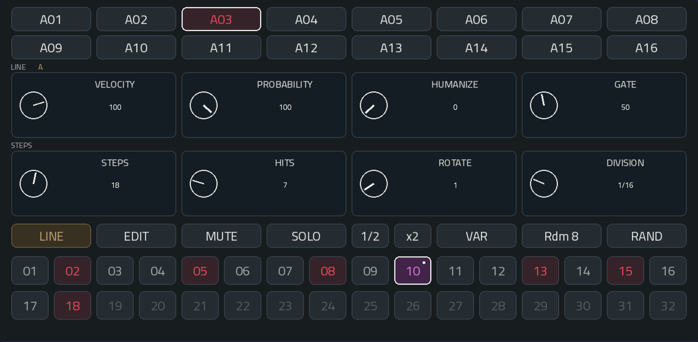
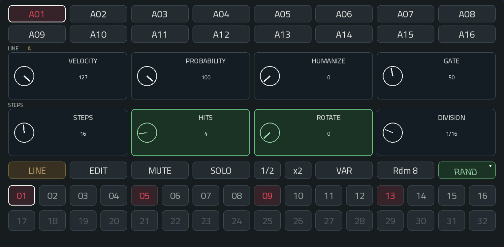
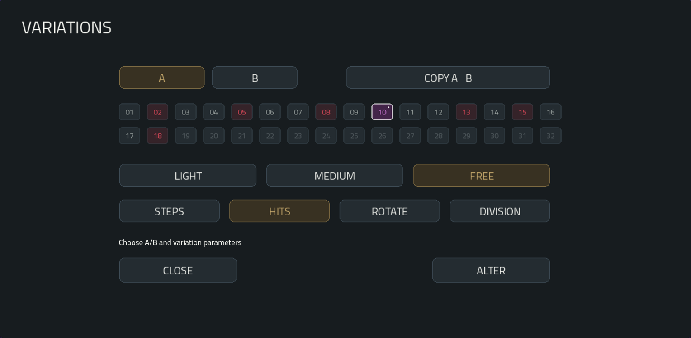
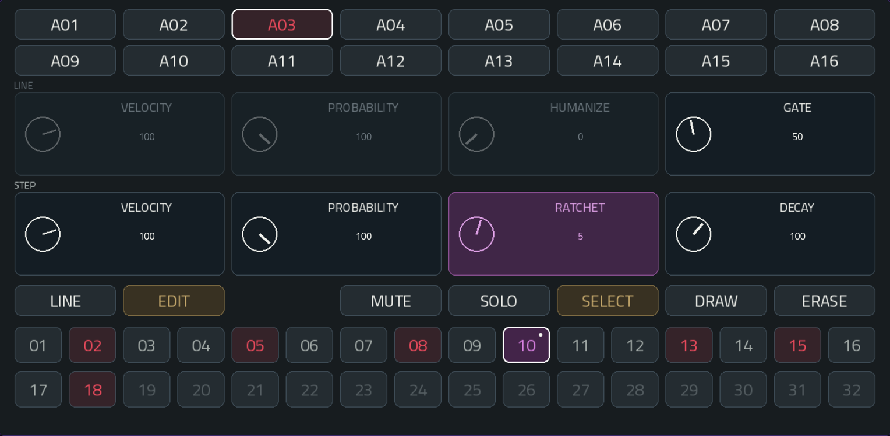
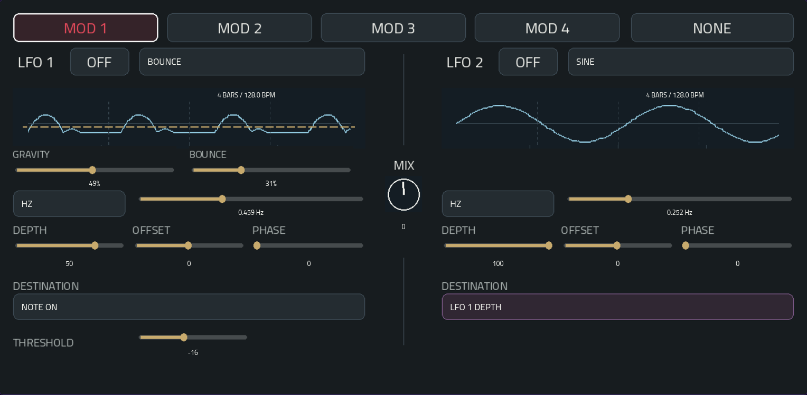
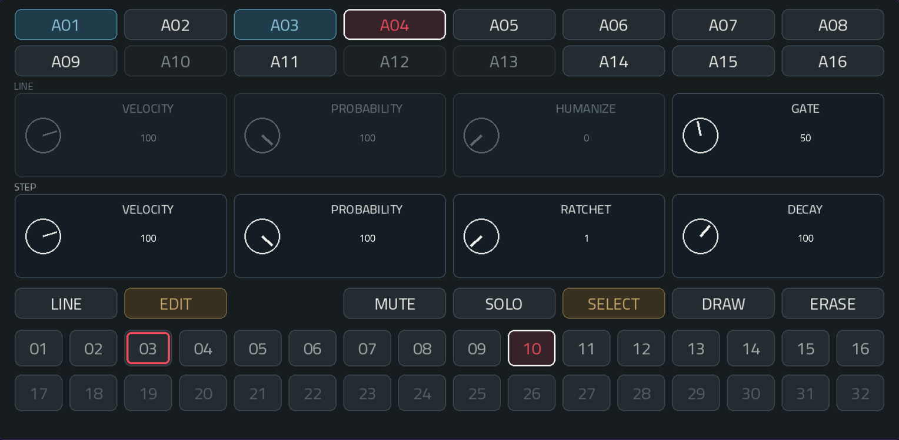
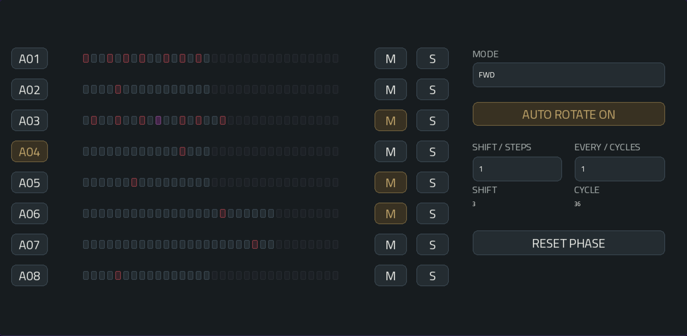
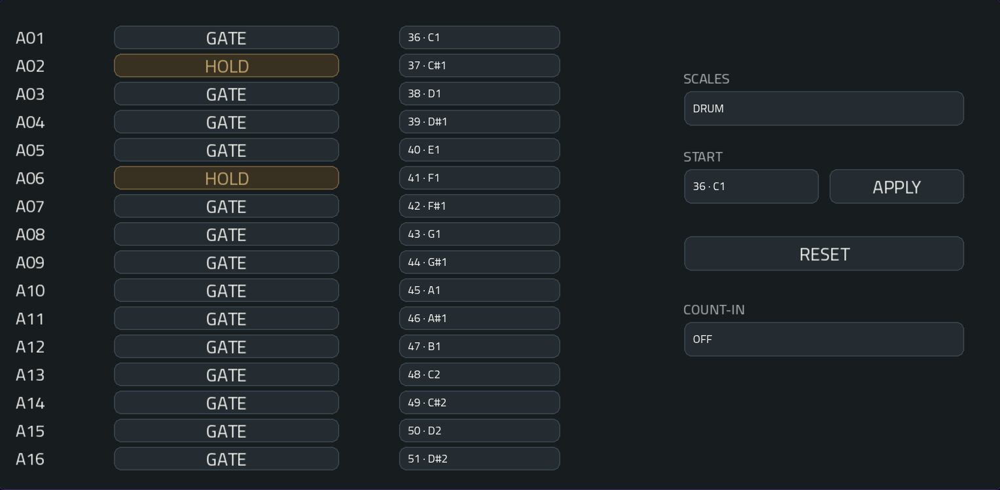
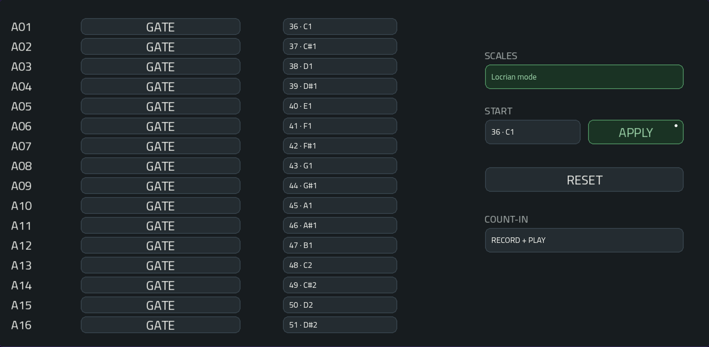

# πClideaN — User Manual

Version 1.3.4

Illustrations captured through Commander, using the current plugin skin and device settings.

## 1. Overview

πClideaN is a MIDI instrument: it produces no audio. Its dedicated MIDI output drives synthesizers, drum instruments and sample tracks.

This hybrid sequencer combines Euclidean pattern generation, step-by-step editing, parameter locks, selective randomization and probability.

Auto-rotation, different playback directions and LFO modulation let patterns and their triggers evolve.

Each of its sixteen lanes has an independent pattern length and rhythmic division.

Patterns can loop for different durations while staying synchronized to the tempo, creating polymeters and evolving rhythmic offsets.

Five pages: PATTERN, MOD, 01 - 08, 09 - 16 and CONFIG.

**A01–A16** select a pattern (lane).

A white outline identifies the selected pattern.

## 2. Connect a target

Choose the sounds you want to play. πClideaN supplies the rhythm.

Load πClideaN on a plugin track, then load the target on another track: a synthesizer, drum instrument or Drum Track.

On that target, select this MIDI input:

`piClideaN MPC Out`

Receive **channel 1** or all channels. Each plugin instance has its own port; additional ports are numbered.

Open CONFIG and assign each lane’s **MIDI NOTE** to a pitch or target sound.

For melodic patterns, choose a **SCALE** and **START** note, then **APPLY**. For drums, match the MIDI notes to the kit’s pads.

The default notes are **36–51**. All output uses channel 1.

Press Play on the host. πClideaN follows its tempo, position and loops.

Use distinct notes for independent sounds, and avoid receiving the same output through two routes.

## 3. PATTERN — LINE

Choose a pattern from **A01 to A16**, then **LINE**. 

Build a rhythm and give the whole lane its character.

### Shape the rhythm

The lower STEPS row sets the pattern:

**STEPS** chooses its length: 1–32 steps.

**HITS** spreads 0–STEPS hits across that length.

**ROTATE** moves the generated pattern around its cycle.

**DIVISION** sets the pace of each step: 1/32, 1/16, 1/8, 1/4 or 1/2 note.

Try different lengths and divisions on different lanes to hear their cycles meet and drift apart.

Manual trigger edits override the generated pattern. Data beyond the current length stays stored.

### Give it expression

The upper LINE row shapes how the lane plays:

**VELOCITY** sets the strength of its hits: 1–127.

**PROBABILITY** lets some hits take a chance: 0–100%, decided once for the whole trigger group, ratchets included.

**HUMANIZE** varies velocity by up to the chosen amount: 0–50, once per group.

**GATE** sets how long notes stay held: 10–95% of a step or ratchet subdivision. It applies in GATE mode; see CONFIG for HOLD.

### Play with the lane

**MUTE** silences the lane.

**SOLO** lets you listen to one or more lanes together. Mute takes precedence.

Active buttons turn **amber**.

**1/2** slows the lane down.

**x2** speeds it up.

Both move through the available rhythmic divisions.

### Selective RANDOM

Keep what you like. Let chance explore the rest.

Press **RAND** once to open selection. The button turns green and italic, with a small white dot.

Tap the control areas you want to vary. They turn **green**; their values stay unchanged for now.

Press **RAND** again to apply the randomization. Only selected parameters change, then selection closes.

All eight controls can be selected, across the LINE and STEPS rows. The illustration selects **HITS and ROTATE**.

With nothing selected, nothing changes. Choosing another lane or switching LINE/EDIT cancels selection.

Q-Link editing, 1/2 and x2 pause during selection.

A new Steps value respects unselected Hits and Rotate. If RAND changes Steps, Hits or Rotate, manual trigger overrides are cleared; step expression is retained.

A random result can equal the previous value.

RAND, ALTER and Rdm 8 limit generated active steps to **75% of each lane length**, rounded down (12/16, 24/32). Manual editing remains unrestricted. In selective RAND, unselected parameters are preserved; if the density constraint is impossible, the lane stays unchanged and selection closes. A one-step generated lane is silent. This limit does not reduce ratchet repeats or independent LFO triggers.

### ALTER and A/B — develop a lane

Tap **VAR** to open VARIATIONS. **RAND** keeps the normal two-stage parameter-selection workflow; no long press is needed.

Select **STEPS, HITS, ROTATE and/or DIVISION**, then choose **LIGHT, MEDIUM or FREE**. **ALTER** compares bounded candidates for resemblance, cyclic anchors, density and spacing.

**A / B** switches between two rhythmic versions of the selected lane. First use starts with matching versions. Edits belong to the selected version.

**COPY A → B** replaces B with A and selects B. It is a useful way to make a safe starting copy.

Starting from **A**, **ALTER** preserves A and places its result in B. Starting from **B**, another ALTER develops B while keeping A. **CLOSE** returns to PATTERN with the selected version still active.

**LIGHT** stays close to the starting rhythm. **MEDIUM** allows larger changes. **FREE** explores more widely; protected values and density limits still apply. FREE does not mean a completely unrestricted reset.

The screenshot is ready to alter **HITS only**, at FREE strength. The 32-step preview keeps the lane’s active, locked and unused steps visible.

A/B switches immediately, rather than waiting for the next bar. Held notes owned by that lane are released.

A/B stores rhythm and step customizations. Notes, LINE settings, MUTE/SOLO, HOLD, traversal and MOD stay shared. Locks remain at their original step indices, even if shortening hides them. Incompatible protections or density constraints leave the lane unchanged.

### Rdm 8 — generate eight patterns together

Tap **Rdm 8**, then **APPLY**. **CANCEL** changes nothing.

Lanes **01–08** are generated together using shared timing occupancy to favour anchors, responses and space. **09–16 remain untouched.**

On 01–08, step edits and A/B reset; Velocity/Probability return to 100, Humanize to 0 and Gate to 50. HOLD, Solo, traversal and autorotation reset; MOD slots assigned to those lanes return to NONE/OFF.

A preserved SOLO on 09–16 can keep the new 01–08 lanes inaudible.

**MUTE**, **MIDI pitches** and the **applied scale** are preserved. Search runs in the background; changing context during calculation may discard its result.

A useful starting point: generate eight lanes with Rdm 8, keep unwanted lanes muted, then use VAR to develop one lane at a time.

## 4. PATTERN — EDIT

Give one hit its own character.

In the screenshot, **A03 / step 10** has **RATCHET 5**. The full violet box and violet step identify its custom setting.

Choose **EDIT**, then select a step. The lower **STEP** row now belongs to that step.

**VELOCITY** replaces its lane velocity: 1–127.

**PROBABILITY** replaces its lane probability: 0–100%. The two probabilities are not multiplied.

**RATCHET** turns the step into 1–8 evenly spaced hits.

**DECAY** shapes their velocity: 0–150% of the previous repeat. At 100, repeats stay even; below 100 they fade; above 100 they grow, limited to 127.

At DECAY 0, only the first hit plays. With one hit, Decay has no effect.

Without custom values, velocity and probability follow the lane; ratchet is 1 and decay is 100.

**GATE**, at the upper right in EDIT, sets a duration lock for the selected step: 10–95% of the step or each ratchet subdivision. Without a lock it inherits LINE GATE. HOLD takes priority; switching back to GATE restores these stored durations.

The full control box turns **purple** when the step has a stored lock. Other upper-row LINE references stay read-only. ERASE in SELECT clears the step’s expression locks, including GATE; in DRAW it removes the trigger.

### Select, draw, erase

**SELECT** explores a step without changing its trigger.

**DRAW** turns the touched trigger on or off.

Changing expression alone does not add a note.

**ERASE** follows your editing mode:

- In SELECT, clear custom step expression and keep the trigger.
- In DRAW, remove the trigger and keep its expression.

Edits are immediate; there is no undo.

In EDIT, the dimmed VELOCITY, PROBABILITY and HUMANIZE controls remain lane references. The upper-right GATE edits the selected step. Return to LINE to change lane defaults.

## 5. MOD — dual LFO modulation

Add movement to a lane, or let a waveform create its own triggers.

Choose **MOD 1–MOD 4**, then assign a **PAD** through the selection panel.

Each lane can use one slot. By default, every slot is **NONE** and both LFOs are **OFF**.

Selecting MOD does not change the lane selected in PATTERN.

To play the illustrated routing, assign a lane and enable the relevant LFOs. The screenshot prepares BOUNCE → NOTE ON and LFO 2 → LFO 1 DEPTH, with the LFOs still OFF.

### Build the movement

Switch the LFO **ON** and choose a shape:

Sine, Triangle, Ramp Up, Ramp Down, Square, Sample & Hold, Random Smooth, Free Curve, Random Walk, Random Loop or Bounce.

**SQUARE** adds pulse width. **RANDOM WALK** adjusts random step size. **RANDOM LOOP** sets loop length and evolution. **BOUNCE** adjusts gravity and restitution.

**SYNC** fits its cycle to the tempo: 1/16 note to 4 bars.

**HZ** sets its frequency independently: 0.05–20 Hz.

**DEPTH** sets the modulation amount: −100 to +100. Negative values invert it.

**OFFSET** shifts its level. **PHASE** shifts its position within the cycle: 0–359°.

For **FREE CURVE**, draw your own shape with eight sliders.

Choose a **DESTINATION**:

NONE, Velocity, Probability, Humanize, Gate, Ratchet, Decay or Note On.

Parameter modulation affects playback. Your stored lane and step values remain intact.

### Chain the LFOs

Choose **LFO 2 RATE, DEPTH or OFFSET** as LFO 1’s destination, or the corresponding LFO 1 destination from LFO 2.

One shape then moves the other: for example, Random Walk can vary the depth of a note-triggering LFO.

Stored settings remain intact. Mutual modulation uses the previous control value and stays bounded.

Chained destinations are purple; a small dot marks the receiving parameter. MIX remains separate from the chaining path.

### Mix the two shapes

Turn **MIX** toward the source you want to hear in the modulation:

- −100: LFO 1 only.
- 0: equal blend.
- +100: LFO 2 only.

Each LFO keeps its own destination. An enabled source set to NONE can still contribute to the mix.

### Let the LFO trigger notes

Choose **NOTE ON**, then adjust **THRESHOLD**:

An upward crossing starts a note.

A downward crossing releases it.

While that note is held, step triggers on the same note/channel are suppressed.

The sequencer keeps advancing, then resumes at the next normal trigger after release.

### Read the curves

The previews show **four bars** at the current tempo. They stay still until relevant settings change.

The dashed amber line marks the threshold. Each curve shows one source; actual crossings depend on the mixed signal.

Random shapes show an example, not the next played sequence. Very fast periodic shapes may appear as an amplitude band; random shapes retain a trajectory.

OFF and inaudible lanes suspend phase. Re-enabling resumes from that phase without immediately firing a note already above threshold.

Reassigning a PAD releases its previous LFO note.

## 6. Muted lanes and activity

Follow the rhythm by watching **A01–A16**.

The screenshot keeps **A04** selected while **A01 and A03** flash azure. Dimmed buttons identify muted lanes; the red inner border on step 03 is the playhead.

An **azure pulse** marks an emitted note reaching playback time. Your selected lane keeps its white outline.

Muted lanes, solo-excluded lanes, rests and probability-rejected hits do not flash. Pulses last about 140 ms; fast ratchets can merge visually.

HOLD flashes on retriggers, not throughout the held note. This feedback represents MIDI activity, not measured sound.

Muted lane buttons are dimmed. Selecting one does not unmute it; its selection border stays visible. Solo exclusion alone does not dim selectors.

### Colors at a glance

**Red step:** trigger on.

**Violet step:** custom expression. A violet rest remains silent.

**White outer border:** selected step.

**Red inner border:** playhead.

**Amber button:** active mode or toggle.

**Green:** RAND selection.

A purple expression-control box marks a stored step lock. The step is purple when it has expression locks; its small dot remains an additional customization indicator. On a lane button, it marks an enabled modulation destination.

## 7. 01 - 08 / 09 - 16 — playback and rotation

Step back and watch eight lanes play together.

Select a lane to work with its controls on the right. **M** and **S** act on their own row.

Each preview shows 32 steps. Muted patterns remain visible; a light outline marks playback without hiding the step’s color.

### Change direction

Tap **MODE** to open the direction panel. Choose a mode to apply it and close the panel; **CANCEL** keeps the current mode.

**FWD / REV:** travel forward or backward.

**PEND1:** go back and forth, repeating endpoints: 1–2–3–4–4–3–2–1.

**PEND2:** turn around without repeating endpoints: 1–2–3–4–3–2.

**URN:** visit every step once, in a shuffled order each cycle.

### Make the pattern rotate

Switch **AUTO ROTATE ON**.

**SHIFT / STEPS** chooses the movement: −8 to +8 steps. Negative values move in the opposite direction.

**EVERY / CYCLES** chooses the interval: 1–16 lane cycles. For example, SHIFT / STEPS 1 and EVERY / CYCLES 2 rotate the pattern one step every two complete lane cycles.

A cycle follows the playback mode, not necessarily a host bar. Step expression moves with its trigger; selection follows its stored data.

**RESET PHASE** requests a fresh phase at the next step boundary during playback.

The small **SHIFT** and **CYCLE** readouts show the current accumulated rotation and lane cycle.

The screenshot selects **A04**; AUTO ROTATE is ON. The amber M buttons mute A03, A05 and A06. These row buttons act independently of the selected lane.

## 8. CONFIG — MIDI notes and GATE / HOLD

Give each lane its sound and choose how it holds a note.

**MIDI NOTE** sets the output note: 0–127, with its Force note name, for example **36 · C1**.

Tap **GATE / HOLD** beside a lane to change its note behaviour. The overview shows HOLD on A02 and A06; other lanes use GATE.

The overview uses **DRUM**, with notes 36–51. The next illustration shows a prepared change awaiting validation.

### Play a scale

**SCALES** opens a button panel. Choose DRUM, a scale or a mode.

**START** selects a complete starting note: root and octave.

A changed **SCALES** or **START** field turns green, along with **APPLY**. Only the changed field is highlighted. The pitches stay unchanged until APPLY.

Here, **Locrian mode** is prepared at **36 · C1**, but the sixteen note fields still contain the DRUM assignment. Pressing APPLY would assign the ascending scale; selecting a scale alone does not change playback.

**RESET** restores DRUM, notes 36–51, without changing patterns, step customizations or GATE/HOLD.

If sixteen notes exceed the MIDI range, lower START before applying.

### Short hits: GATE

The dark **GATE** button uses the note duration set in PATTERN.

At 120 BPM and 1/16 division, a step lasts 125 ms. GATE 50 holds it for 62.5 ms; with ratchet 4, each repeat is held for about 15.6 ms.

Normal host loop returns preserve independent lane cycles and note tails. Stop or a deliberate transport seek is a separate action.

### Let it continue: HOLD

The amber **HOLD** button keeps the note held until the lane’s next effective trigger. The old note is released before the new one starts.

Rests and probability-rejected hits leave it playing. Ratchets retrigger; the final repeat remains held.

The Gate percentage stays stored but is inactive in HOLD.

Switching modes, Stop, Mute and Solo exclusion release owned notes.

HOLD suits long samples and sustained instruments. It cannot extend a finished sample: the target must respond to Note Off, which One Shot may ignore.

Use distinct notes for independent lanes. Shared note/channel combinations use overlap protection.

### COUNT-IN — match the host

Set **COUNT-IN** to match MPC’s own count-in setting:

- **OFF:** no additional wait.
- **RECORD:** wait when recording starts.
- **RECORD + PLAY:** wait when playback or recording starts.

This does not enable MPC’s metronome or count-in. It tells πClideaN when to hold back pattern and LFO notes. An eight-beat safety timeout prevents indefinite waiting if the settings differ. The example shows RECORD + PLAY.

## 9. Q-Links and automation

Reach for the Q-Links to play the controls directly.

On PATTERN in **LINE**:

- Q1–Q4: Velocity, Probability, Humanize, Gate.
- Q5–Q8: Steps, Hits, Rotate, Division.

In **EDIT**:

- Q1–Q3: read-only LINE references.
- **Q4: GATE of the selected step.**
- Q5–Q8: step Velocity, Probability, Ratchet, Decay.

On **MOD**:

- Q1–Q4: LFO 1 Depth, Offset, Phase, Threshold.
- Q5–Q8: the same for LFO 2. MIX has its own knob.

The track pages expose lane selection and playback/rotation controls. CONFIG uses touch and the data wheel.

A white focus outline shows what the wheel will change.

For host automation, use the dedicated lane and step parameters. Contextual aliases depend on selection.

Lane automation still runs in EDIT. Step automation addresses stored source steps, which can move under rotation.

Host automation is separate from MIDI CC input: this plugin does not record or replay CC.

## 10. Presets, projects and playback

Start with **INIT** for sixteen silent lanes and the default notes, then draw hits or use Rdm 8.

The native **PRESET** menu also offers Straight Four, Broken Grid, Polymeter, Dorian Flow, Slow Orbit and Step Expression. Loading a preset replaces the instrument’s current settings.

Found a rhythm you like? Save your own preset through the host’s native menu, or **save the host project**.

The saved instrument state includes both A/B variants, patterns, step expression, MIDI notes, applied scale, GATE/HOLD, COUNT-IN, playback settings and all four MOD slots.

Version 1.3.4 reads older states. Its A/B state extension cannot be read by older binaries: retain original project copies if you need to return to them.

Held notes and live LFO phases are not saved. Stop releases owned notes.

πClideaN does not create native clips, drive physical pad LEDs or produce audio. Scheduling limits are described in the engine documentation.

### Rhythmic preferences

ALTER and Rdm 8 use compact preferences extracted offline from Groove MIDI Dataset: cyclic spacing, compatible metric positions, densities and overlaps. Operation is entirely local to the instrument. This does not add swing, timing humanization or harmonic generation. [Details and credits](GROOVE-STATISTICS.md).
